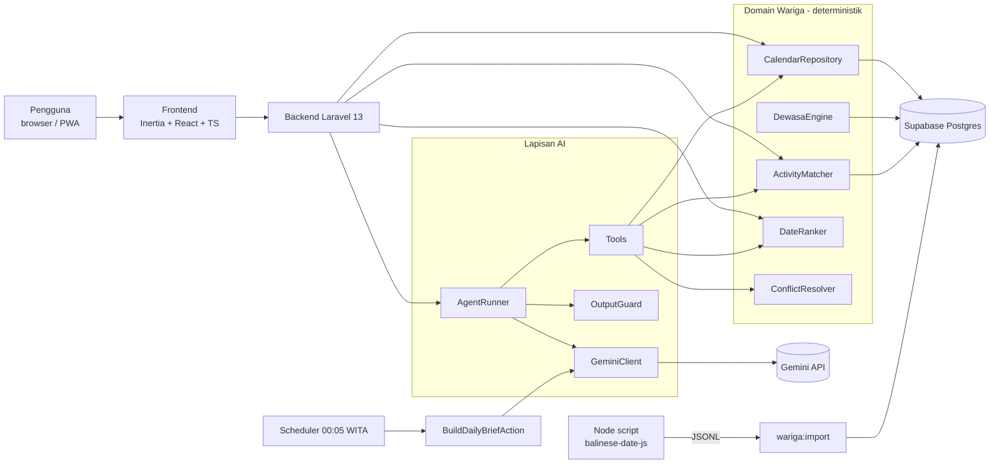

# ARCHITECTURE.md — Rahina

## 1. Diagram Sistem



## 2. Alur Utama

### 2.1 Pre-compute (sekali + saat aturan berubah)

```
node scripts/calendar/compute.mjs 2020 2035
  → storage/app/calendar/YYYY.jsonl  (1 baris per hari)
php artisan wariga:import            → calendar_days, calendar_day_rahinan
php artisan wariga:compute-dewasa    → calendar_day_dewasa (evaluasi conditions)
```

### 2.2 Kalender & Rahina Ini

`GET /?bulan=YYYY-MM` → `CalendarController`: grid 6 minggu (data hasil hitung + jumlah dewasa yang boleh tampil per tanggal), panel hari ini, rahinan mendatang. **Tanpa AI.**
Klik tanggal → popup → `GET /hari/{tanggal}` (JSON, `DayDetailController`): detail lengkap (wewaran + urip, paringkelan, rahinan, dewasa + sumber) dan ringkasan `BuildDailyBriefAction`: cek `daily_briefs` → belum ada: generate sinkron (Gemini timeout 10s) → OutputGuard → gagal / batas laju (20/menit): template.

### 2.3 Tanya Wariga

`POST /ask` → `AskWarigaAction` → `AgentRunner` (function calling, maks 4 langkah) → `OutputGuard` → JSON → UI menampilkan `DateRefCard`.

### 2.4 Perencana

`GET /plan?activity=...&start=...&end=...` → `ActivityMatcher` → `DateRanker` → (opsional) penjelasan LLM → ekspor `.ics`.

## 3. Keputusan Teknis

| Keputusan                                        | Alasan                                                                                                |
| ------------------------------------------------ | ----------------------------------------------------------------------------------------------------- |
| Pre-compute kalender ke DB                       | Query cepat, mudah diuji, LLM cukup memanggil data                                                    |
| Engine JS dipanggil dari Node, bukan port ke PHP | Memakai library teruji (MIT, port dari lib Apache-2.0); port PHP bisa dilakukan setelah lomba         |
| Aturan dewasa sebagai data JSON, bukan kode      | Bisa divalidasi & dikoreksi pakar tanpa deploy ulang; setiap hasil bisa dijelaskan                    |
| Satu model `gemini-3.1-flash-lite`               | Cepat & murah, mendukung function calling + JSON schema; tanpa embedding sehingga cukup satu API key  |
| Function calling, bukan RAG untuk tanggal        | RAG tidak menjamin tanggal benar; function calling mengembalikan data pasti                           |
| Cache brief per hari                             | 1 panggilan LLM per hari untuk semua user → hemat kuota                                               |
| Laravel + Inertia                                | Stack utama tim, satu repo, cepat dikembangkan                                                        |
| Supabase hanya sebagai Postgres                  | Tidak perlu hosting database sendiri; tetap Postgres standar sehingga bisa pindah tanpa mengubah kode |

## 4. Deployment

| Komponen   | Pilihan                                                                                                                                                                  |
| ---------- | ------------------------------------------------------------------------------------------------------------------------------------------------------------------------ |
| App        | [isi] hosting PHP 8.3+ yang bisa menjalankan queue worker + scheduler (cron tiap menit) dan koneksi keluar IPv4                                                          |
| DB         | **MySQL 8** (lokal: Laragon; produksi: MySQL di host yang sama/berdekatan dengan aplikasi). Supabase ditinggalkan 2026-11-06 karena latensi, lihat `SUPABASE.md` (arsip) |
| Backup     | `db:backup` mingguan (`pg_dump`) ke penyimpanan di luar Supabase                                                                                                         |
| Anti-pause | Aktivitas scheduler harian + `health:ping` tiap 6 jam; cek dashboard H-3 penjurian                                                                                       |
| Domain     | HTTPS wajib (untuk PWA & notifikasi)                                                                                                                                     |
| Monitoring | Laravel log + tabel `ai_interactions`, health check `/up`                                                                                                                |

Sebelum penjurian: isi cache brief 14 hari ke depan (`php artisan brief:generate --days=14`) agar demo tidak bergantung pada kuota API.
