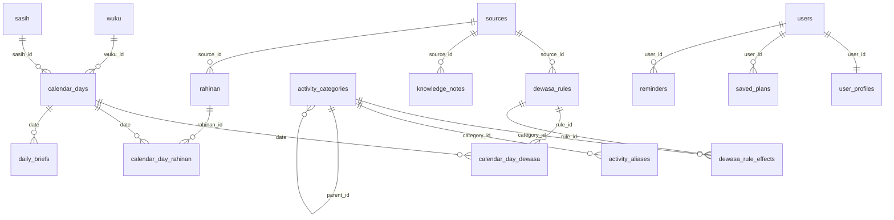

# DATABASE_SCHEMA.md — Rahina

## 0. Database

**MySQL 8** (sejak 2026-11-06; sebelumnya Supabase/PostgreSQL, ditinggalkan karena latensi, lihat `SUPABASE.md` arsip). Test memakai SQLite in-memory. Kode portabel ke tiga driver: bagian khusus Postgres (`pg_trgm`, index parsial/GIN, CHECK constraint, RLS) dibungkus `DB::getDriverName() === 'pgsql'`; di MySQL/SQLite pemetaan aktivitas memakai trigram di PHP (`ActivityMatcher`). Kolom `jsonb` di migrasi menjadi `json` di MySQL. Tidak memakai vektor/embedding.

Setup lokal (Laragon): `CREATE DATABASE rahina CHARACTER SET utf8mb4 COLLATE utf8mb4_unicode_ci;` lalu `php artisan migrate --seed`, `wariga:import storage/app/calendar`, `wariga:compute-dewasa` (±18 detik untuk 2020–2035).
Zona waktu aplikasi `Asia/Makassar`; tanggal kalender disimpan sebagai `date` (tanggal sipil Masehi).

## 1. Gambaran Kelompok Tabel

| Kelompok              | Tabel                                                                             | Diisi oleh                            |
| --------------------- | --------------------------------------------------------------------------------- | ------------------------------------- |
| Master wariga         | `wuku`, `wewaran_values`, `sasih`, `rahinan`                                      | Seeder (dari buku)                    |
| Kalender hasil hitung | `calendar_days`, `calendar_day_rahinan`                                           | `wariga:import` (engine)              |
| Aturan dewasa         | `dewasa_rules`, `dewasa_rule_effects`, `dewasa_precedence`, `calendar_day_dewasa` | Seeder + `wariga:compute-dewasa`      |
| Aktivitas             | `activity_categories`, `activity_aliases`                                         | Seeder + alias terkonfirmasi pengguna |
| Pengetahuan & sumber  | `sources`, `knowledge_notes`                                                      | Kurasi manual                         |
| Pengguna              | `users`, `user_profiles`, `saved_plans`, `reminders`                              | Aplikasi                              |
| AI                    | `daily_briefs`, `ai_interactions`                                                 | Aplikasi                              |

## 2. ERD



## 3. Definisi Tabel

### 3.1 Master wariga

**`wuku`** (30 baris)

| Kolom       | Tipe               | Keterangan                 |
| ----------- | ------------------ | -------------------------- |
| id          | smallint PK        | 1–30 sesuai urutan         |
| name        | varchar(32) unique |                            |
| urip        | smallint           |                            |
| description | text null          | ringkasan sendiri + sumber |
| source_id   | bigint FK null     |                            |

**`wewaran_values`**

| Kolom                   | Tipe          | Keterangan                                                                         |
| ----------------------- | ------------- | ---------------------------------------------------------------------------------- |
| id                      | smallint PK   | **`cycle * 100 + position`** (contoh Kliwon = 504), deterministik antar-lingkungan |
| cycle                   | smallint      | 1 = ekawara … 10 = dasawara                                                        |
| position                | smallint      | urutan dalam siklus, 1-based (55 baris total)                                      |
| name                    | varchar(32)   |                                                                                    |
| urip                    | smallint null |                                                                                    |
| UNIQUE(cycle, position) |               |                                                                                    |

**`sasih`** (20 baris: 12 sasih + 8 mala/nampih, mengikuti engine)

| Kolom          | Tipe               | Keterangan                                                      |
| -------------- | ------------------ | --------------------------------------------------------------- |
| id             | smallint PK        | 1–12 sasih biasa, 13–20 mala/nampih                             |
| name           | varchar(32) unique |                                                                 |
| base_id        | smallint           | sasih dasar (1–12); untuk nampih menunjuk sasih yang digandakan |
| is_intercalary | boolean            | true untuk mala/nampih                                          |
| alt_name       | varchar(32) null   |                                                                 |

**`rahinan`** (31 baris dari engine, id = id engine + 1)

| Kolom       | Tipe                                                               | Keterangan                                    |
| ----------- | ------------------------------------------------------------------ | --------------------------------------------- |
| id          | smallint PK                                                        |                                               |
| slug        | varchar(64) unique                                                 |                                               |
| name        | varchar(64)                                                        |                                               |
| kind        | enum(`pawukon`,`sasih`,`kajeng_kliwon`,`purnama_tilem`,`nasional`) | dasar perhitungan (CR-005)                    |
| description | text null                                                          | diisi dari sumber tervalidasi, bukan dikarang |
| source_id   | FK null                                                            | engine untuk rahinan hasil hitung             |

Data master di-seed dari `database/data/wariga_master.json` (dihasilkan `node scripts/calendar/masters.mjs`).

### 3.2 Kalender hasil hitung

**`calendar_days`** (±5.800 baris untuk 2020–2035)

| Kolom                    | Tipe                           | Keterangan                                                            |
| ------------------------ | ------------------------------ | --------------------------------------------------------------------- |
| date                     | date PK                        |                                                                       |
| saka_year                | smallint                       |                                                                       |
| wuku_id                  | smallint FK                    |                                                                       |
| ekawara_id … dasawara_id | smallint FK → `wewaran_values` | 10 kolom, nullable untuk ekawara                                      |
| urip_total               | smallint                       | saptawara + pancawara                                                 |
| sasih_id                 | smallint FK                    |                                                                       |
| sasih_day                | smallint                       | 1–15                                                                  |
| sasih_day_end            | smallint null                  | hanya saat ngunaratri (dua hari sasih dalam satu hari), contoh 15 → 1 |
| is_penanggal             | boolean                        | false = panglong                                                      |
| is_purnama               | boolean                        |                                                                       |
| is_tilem                 | boolean                        |                                                                       |
| is_nguna_ratri           | boolean                        |                                                                       |
| ingkel                   | varchar(16) null               |                                                                       |
| engine                   | varchar(32)                    | contoh `balinese-date-js@1.0.1`                                       |
| computed_at              | timestamptz                    |                                                                       |

Index: `(wuku_id)`, `(sasih_id, sasih_day)`, `(date) WHERE is_purnama`, `(date) WHERE is_tilem` (parsial hanya di Postgres).

**`calendar_day_rahinan`**: `date` FK, `rahinan_id` FK, PK(date, rahinan_id).

### 3.3 Aturan dewasa

**`dewasa_rules`**

| Kolom         | Tipe                       | Keterangan                                       |
| ------------- | -------------------------- | ------------------------------------------------ |
| id            | bigint PK                  |                                                  |
| code          | varchar(64) unique         | slug, misal `sampi_gumarang_turun`               |
| name          | varchar(96)                |                                                  |
| summary       | text                       | **ditulis ulang sendiri**, 1–2 kalimat           |
| verdict       | enum(`ayu`,`ala`,`campur`) | sifat umum                                       |
| alahing_level | smallint null              | 1–5 (bobot / tingkat prioritas)                  |
| conditions    | jsonb                      | lihat §4                                         |
| source_id     | FK                         | wajib                                            |
| source_page   | varchar(32) null           |                                                  |
| validated_by  | varchar null               | nama validator                                   |
| validated_at  | timestamptz null           | hanya aturan tervalidasi yang tampil di produksi |
| is_active     | boolean default true       |                                                  |

Index: GIN `(conditions)`.

**`dewasa_rule_effects`**: aturan memengaruhi kategori aktivitas apa.

| Kolom                            | Tipe                       | Keterangan |
| -------------------------------- | -------------------------- | ---------- |
| rule_id                          | FK                         |            |
| category_id                      | FK → `activity_categories` |            |
| effect                           | enum(`baik`,`tidak_baik`)  |            |
| note                             | text null                  |            |
| PK(rule_id, category_id, effect) |                            |            |

**`dewasa_precedence`**: urutan prioritas antar-unsur, **hanya** dari sumber tertulis.

| Kolom       | Tipe         | Keterangan                                             |
| ----------- | ------------ | ------------------------------------------------------ |
| id          | smallint PK  |                                                        |
| layer       | varchar(32)  | contoh `wewaran`, `wuku`, `penanggal`, `sasih`, `dauh` |
| rank        | smallint     | makin besar makin kuat                                 |
| source_id   | FK           |                                                        |
| source_page | varchar null |                                                        |

**`calendar_day_dewasa`** (hasil `wariga:compute-dewasa`)

| Kolom             | Tipe                                                      |
| ----------------- | --------------------------------------------------------- |
| date              | date FK                                                   |
| rule_id           | bigint FK                                                 |
| matched_on        | jsonb (unsur yang membuat aturan cocok, untuk penjelasan) |
| PK(date, rule_id) |                                                           |

### 3.4 Aktivitas

**`activity_categories`**

| Kolom                    | Tipe                                                                       | Keterangan                                              |
| ------------------------ | -------------------------------------------------------------------------- | ------------------------------------------------------- |
| id                       | bigint PK                                                                  |                                                         |
| parent_id                | FK null                                                                    | hierarki: domain → sub-kategori                         |
| code                     | varchar unique                                                             | `pertanian.padi`, `pertanian.umbi`, `dagang.buka_usaha` |
| domain                   | enum(`upacara`,`pertanian`,`peternakan`,`peralatan`,`pembangunan`,`aneka`) | 6 domain umum kalender Bali                             |
| name                     | varchar                                                                    |                                                         |
| icon                     | varchar                                                                    | nama ikon Phosphor                                      |
| requires_cultural_notice | boolean                                                                    | true untuk upacara besar                                |

**`activity_aliases`**: bahan pemetaan bahasa bebas.

| Kolom       | Tipe                                          |
| ----------- | --------------------------------------------- |
| id          | bigint PK                                     |
| category_id | FK                                            |
| phrase      | varchar (misal "nanam singkong", "tanam ubi") |
| source      | enum(`seed`,`user_confirmed`)                 |

Index: GIN `(phrase gin_trgm_ops)`.

### 3.5 Sumber & pengetahuan

**`sources`**

| Kolom                          | Tipe                                                   | Keterangan                                                          |
| ------------------------------ | ------------------------------------------------------ | ------------------------------------------------------------------- |
| id                             | bigint PK                                              |                                                                     |
| code                           | varchar(64) unique                                     | slug stabil untuk seeder, contoh `balinese-date-js`, `ardhana-2005` |
| kind                           | enum(`book`,`lontar`,`journal`,`interview`,`software`) |                                                                     |
| title, author, year, publisher |                                                        |                                                                     |
| url                            | text null                                              |                                                                     |
| license                        | varchar                                                | `copyright`, `CC0`, `CC-BY-4.0`, `Apache-2.0`, `izin-narasumber`    |
| notes                          | text null                                              |                                                                     |

**`knowledge_notes`**: bahan RAG untuk penjelasan konsep (bukan untuk tanggal).

| Kolom         | Tipe                                              | Keterangan                                                         |
| ------------- | ------------------------------------------------- | ------------------------------------------------------------------ |
| id            | bigint PK                                         |                                                                    |
| topic         | varchar                                           | `wewaran`, `pawukon`, `alahing_dewasa`, nama dewasa, dll.          |
| content       | text                                              | **catatan ringkasan sendiri** (maks ±120 kata), bukan salinan buku |
| source_id     | FK                                                |                                                                    |
| source_page   | varchar null                                      |                                                                    |
| search_vector | tsvector (generated: `to_tsvector('simple', topic |                                                                    | ' ' |     | content)`) |     |

Index: GIN `(search_vector)`.

### 3.6 Pengguna

**`user_profiles`**

| Kolom                                                    | Tipe                                   | Keterangan                                       |
| -------------------------------------------------------- | -------------------------------------- | ------------------------------------------------ |
| user_id                                                  | FK PK                                  |                                                  |
| persona                                                  | **dihapus** (2026-11-06), tidak dibuat |                                                  |
| birth_date                                               | date null                              | opsional, untuk otonan; **tidak dikirim ke LLM** |
| otonan_wuku_id, otonan_saptawara_id, otonan_pancawara_id | smallint null                          | diturunkan dari birth_date                       |
| notify_daily                                             | boolean                                |                                                  |

**`saved_plans`**: `id`, `user_id`, `category_id`, `chosen_date`, `note`, timestamps.
**`reminders`**: `id`, `user_id`, `kind` (`otonan`,`rahinan`,`plan`), `ref_id`, `remind_on`, `sent_at` null.

### 3.6b WhatsApp (lihat `WHATSAPP.md`)

**`whatsapp_subscriptions`**

| Kolom                                                    | Tipe                                                   | Keterangan               |
| -------------------------------------------------------- | ------------------------------------------------------ | ------------------------ |
| id                                                       | bigint PK                                              |                          |
| user_id                                                  | FK null                                                | boleh tanpa akun web     |
| phone_encrypted                                          | text                                                   | nomor E.164, terenkripsi |
| phone_hash                                               | char(64) unique                                        | HMAC untuk pencarian     |
| birth_date_encrypted                                     | text null                                              | opsional                 |
| otonan_wuku_id, otonan_saptawara_id, otonan_pancawara_id | smallint null                                          |                          |
| frequency                                                | enum(`daily`,`important_only`)                         |                          |
| status                                                   | enum(`pending`,`active`,`paused`,`opted_out`,`failed`) |                          |
| consent_daily_at                                         | timestamptz                                            | bukti opt-in             |
| consent_birthdate_at                                     | timestamptz null                                       |                          |
| verified_at                                              | timestamptz null                                       |                          |
| opted_out_at                                             | timestamptz null                                       |                          |
| last_inbound_at                                          | timestamptz null                                       |                          |
| consecutive_failures                                     | smallint default 0                                     |                          |
| last_sent_on                                             | date null                                              | idempotensi pesan pagi   |

Implementasi 2026-11-06 (`2026_11_06_000001_create_whatsapp_tables`): otonan dihitung dari tanggal lahir dengan siklus 210 hari (`App\Wariga\Otonan`), sehingga kolom `otonan_*` tidak dibuat. `whatsapp_messages` memakai `brief_date` + UNIQUE(subscription_id, kind, brief_date) sebagai pengganti `brief_id`; status tambahan `received` untuk pesan masuk.

**`whatsapp_link_codes`**: `code` char(6) PK, `subscription_id` FK, `expires_at`, `used_at`. (Implementasi 2026-11-06: tanpa `pending_payload`; persetujuan disimpan di langganan.)

**`whatsapp_messages`**

| Kolom                  | Tipe                                              |
| ---------------------- | ------------------------------------------------- |
| id                     | bigint PK                                         |
| subscription_id        | FK                                                |
| direction              | enum(`in`,`out`)                                  |
| provider               | varchar (`fonnte`, `cloud_api`)                   |
| provider_message_id    | varchar null                                      |
| inbound_hash           | char(64) unique null (idempotensi webhook)        |
| kind                   | enum(`morning_brief`,`answer`,`system`,`inbound`) |
| status                 | enum(`queued`,`sent`,`delivered`,`read`,`failed`) |
| error_code             | varchar null                                      |
| brief_id               | FK → `daily_briefs` null                          |
| created_at, updated_at | timestamptz                                       |

Isi teks pesan masuk **tidak** disimpan (hanya hash), sama seperti `ai_interactions`.

### 3.7 AI

**`daily_briefs`** (cache ringkasan; 1 ringkasan umum per hari. Kolom `persona` dipertahankan dengan nilai tetap `umum` sejak persona dihapus 2026-11-06)

| Kolom                                 | Tipe                                    |
| ------------------------------------- | --------------------------------------- |
| id                                    | bigint PK                               |
| date                                  | date FK                                 |
| persona                               | enum                                    |
| content                               | jsonb (lihat `AI_IMPLEMENTATION.md` §3) |
| rule_ids                              | bigint[] (aturan yang dirujuk)          |
| model                                 | varchar                                 |
| prompt_version                        | varchar                                 |
| created_at                            | timestamptz                             |
| UNIQUE(date, persona, prompt_version) |                                         |

**`ai_interactions`** (log tanpa data pribadi)

| Kolom                 | Tipe                                          |
| --------------------- | --------------------------------------------- |
| id                    | bigint PK                                     |
| feature               | enum(`brief`,`ask`,`map_activity`,`conflict`) |
| input_hash            | char(64)                                      |
| tool_calls            | jsonb (nama tool + argumen)                   |
| returned_dates        | date[]                                        |
| dropped_dates         | date[] (dibuang guard)                        |
| model, prompt_version | varchar                                       |
| latency_ms            | int                                           |
| status                | enum(`ok`,`fallback`,`error`,`refused`)       |
| error                 | text null                                     |
| created_at            | timestamptz                                   |

Teks pertanyaan mentah **tidak** disimpan kecuali user mengaktifkan "bantu tingkatkan Rahina".

## 4. Format `dewasa_rules.conditions`

Kondisi dicocokkan dengan kolom `calendar_days`. Struktur logika: `all` (AND) / `any` (OR) / `not`.

```json
{
    "all": [
        { "field": "saptawara", "in": ["<NAMA>"] },
        { "field": "pancawara", "in": ["<NAMA>"] },
        {
            "any": [
                { "field": "wuku", "in": ["<NAMA>", "<NAMA>"] },
                {
                    "field": "sasih_day",
                    "between": [1, 5],
                    "with": { "is_penanggal": true }
                }
            ]
        }
    ]
}
```

> **Ini contoh FORMAT, bukan aturan asli.** Nilai `<NAMA>` diisi dari buku sumber dan wajib divalidasi (`validated_at`).

Field yang didukung: `wuku`, `ekawara`…`dasawara`, `urip_total`, `sasih`, `sasih_day`, `is_penanggal`, `is_purnama`, `is_tilem`, `ingkel`.
Operator: `in`, `not_in`, `eq`, `between`, `gte`, `lte`.

`DewasaEngine` mengevaluasi seluruh aturan aktif per tanggal → menulis `calendar_day_dewasa` + `matched_on`. Proses ini deterministik, bisa diuji, dan bisa dijelaskan ("muncul karena Saptawara = X dan Wuku = Y").

**Semantik penting**

- Nilai nama harus **sama persis** dengan data master (`Buda`, bukan `Budha`). `wariga:load-rules` menolak salah ketik dan menyebut nilainya.
- `between`/`gte`/`lte` hanya untuk `urip_total` & `sasih_day`; field `is_*` hanya `eq` dengan `true/false`.
- `with` = syarat tambahan (AND, kesamaan) pada leaf yang sama.
- **Ngunaratri**: `sasih_day` hari itu berisi dua nilai (mis. 15 dan 1); leaf cocok bila **salah satu** memenuhi.
- **Sasih nampih**: `sasih: ["Kasa"]` **tidak** mencocokkan `Nampih Kasa`. Tulis nama nampih secara eksplisit bila aturan berlaku juga di sana (CR-006).
- `ekawara` kosong pada hari selain Luang: `in` → tidak cocok, `not_in` → cocok.

### 4.1 File aturan: `database/data/dewasa_rules.json`

```json
{
    "rules": [
        {
            "code": "slug_aturan",
            "name": "[[DEWASA:NAMA]]",
            "summary": "Ringkasan 1–2 kalimat dengan kata sendiri.",
            "verdict": "ayu | ala | campur",
            "alahing_level": 1,
            "conditions": {
                "all": [{ "field": "saptawara", "in": ["<NAMA>"] }]
            },
            "source": "ardhana-2005",
            "source_page": "<hlm>",
            "effects": [
                {
                    "category": "pertanian.padi",
                    "effect": "baik | tidak_baik",
                    "note": null
                }
            ],
            "validated_by": "<nama validator>",
            "validated_at": "2026-11-20T10:00:00+08:00"
        }
    ],
    "precedence": [
        {
            "layer": "wewaran",
            "rank": 1,
            "source": "ardhana-2005",
            "source_page": "<hlm>"
        }
    ]
}
```

- `source` = `sources.code`; `category` = `activity_categories.code`.
- Aturan **tanpa** `validated_at` tetap dihitung, tetapi **tidak tampil** di produksi (`CalendarRepository::dewasa()` default hanya yang tervalidasi).
- Satu aturan tidak valid → seluruh file ditolak. Aturan yang dihapus dari file → `is_active = false` (riwayat tetap ada).

Alur: edit JSON → `php artisan wariga:load-rules` → `php artisan wariga:compute-dewasa` (±1 menit untuk 2020–2035 ke Supabase).

## 5. Query Penting

**Hari baik untuk kategori dalam rentang tanggal** (dipakai tool `find_good_days`):

```sql
WITH scored AS (
  SELECT d.date,
         SUM(CASE WHEN e.effect = 'baik' THEN COALESCE(r.alahing_level,1) ELSE 0 END) AS pos,
         SUM(CASE WHEN e.effect = 'tidak_baik' THEN COALESCE(r.alahing_level,1) ELSE 0 END) AS neg,
         ARRAY_AGG(r.id) FILTER (WHERE e.effect='baik') AS support_ids,
         ARRAY_AGG(r.id) FILTER (WHERE e.effect='tidak_baik') AS block_ids
  FROM calendar_days d
  JOIN calendar_day_dewasa cd ON cd.date = d.date
  JOIN dewasa_rules r ON r.id = cd.rule_id AND r.is_active AND r.validated_at IS NOT NULL
  JOIN dewasa_rule_effects e ON e.rule_id = r.id AND e.category_id = ANY(:category_ids)
  WHERE d.date BETWEEN :start AND :end
  GROUP BY d.date
)
SELECT * FROM scored WHERE pos > 0 ORDER BY (pos - neg) DESC, date ASC LIMIT :limit;
```

Skor di atas hanya skor awal. Keputusan akhir untuk hari yang konflik ditentukan `ConflictResolver` berdasarkan `dewasa_precedence`.

**Pemetaan aktivitas (trigram):**

```sql
SELECT category_id, MAX(GREATEST(similarity(phrase, :q), word_similarity(:q, phrase))) AS score
FROM activity_aliases
WHERE phrase % :q OR :q <% phrase
GROUP BY category_id ORDER BY score DESC LIMIT 3;
```

Skor rendah/ambigu → klasifikasi oleh LLM (lihat `AI_IMPLEMENTATION.md` §4).

**Catatan pengetahuan (full-text):**

```sql
SELECT id, topic, content, source_id, source_page,
       ts_rank(search_vector, websearch_to_tsquery('simple', :q)) AS rank
FROM knowledge_notes
WHERE search_vector @@ websearch_to_tsquery('simple', :q) OR topic = :topic
ORDER BY rank DESC LIMIT 3;
```

## 6. Migrasi (urutan)

1. `enable_extensions` (pg_trgm `with schema extensions`)
2. `create_sources_table`
3. `create_wuku_wewaran_sasih_tables`
4. `create_calendar_days_table`
5. `create_rahinan_tables`
6. `create_activity_tables`
7. `create_dewasa_tables`
8. `create_knowledge_notes_table`
9. `create_user_profiles_plans_reminders`
10. `create_ai_tables`
11. `create_whatsapp_tables`
12. `lock_public_schema` (enable RLS semua tabel `public`; ulangi via `db:lock-public` setiap tabel baru)

## 7. Catatan Supabase

- Fungsi `similarity`, `%`, `<%` dari `pg_trgm` berada di schema `extensions`; pastikan `search_path` = `public,extensions`.
- Pantau ukuran DB (batas Free 500 MB).
- Retensi log: `ai_interactions` & `whatsapp_messages` dihapus otomatis setelah 90 hari (`model:prune`).
